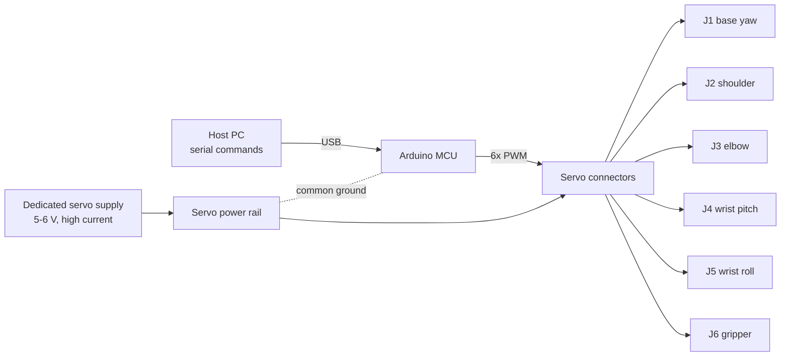

# NexArm

**A servo-actuated robotic arm** — designed, manufactured, and programmed for
**MEP1001: Manufacturing for Innovation**, IIT Delhi.

🏆 **Gold Award** — ManufexLearn 2025, Research & Mega Project category

---

## Overview

NexArm is an articulated robotic arm inspired by the OpenArm platform. The arm carries five
rotational joints plus a servo-driven end effector, giving it a reach and dexterity comparable
to small-scale educational pick-and-place arms.

The project was treated as an end-to-end manufacturing exercise rather than a single build
step: requirements were fixed first, then the arm was modelled as a parametric assembly, each
part was designed around the process that would produce it, the parts were fabricated and
inspected, and finally the electronics and firmware were brought up against the assembled
hardware. Every design change had to survive contact with print tolerances, servo torque limits
and wiring constraints.

The result is a repeatable, serviceable arm whose motion is fully programmable over serial and
whose mechanical design can be re-printed and re-assembled part by part.

**My role:** CAD modelling of the full assembly, manufacturing and inspection of the structural
parts, and the Arduino firmware that drives the joints and executes motion sequences.

---

## Recognition

| | |
|---|---|
| **Award** | Gold — ManufexLearn 2025 |
| **Category** | Research & Mega Project |
| **Course** | MEP1001 — Manufacturing for Innovation, IIT Delhi |

---

## At a glance

| Attribute | Detail |
|---|---|
| Actuation | Hobby-class servo motors, one per joint |
| Control | Arduino-compatible microcontroller, C++ |
| Joint command | 50 Hz PWM, 1–2 ms pulse width → 0–180° |
| CAD | Parametric solid modelling (full assembly + individual part drawings) |
| Fabrication | FDM 3D printing, laser-cut base plate, hand-finished interfaces |
| Motion input | Taught waypoints over serial, executed as interpolated sequences |

---

## System architecture

### Joint layout

| # | Joint | Axis | Motion | Function |
|---|---|---|---|---|
| J1 | Base yaw | Vertical | Rotation | Sweeps the whole arm around the base |
| J2 | Shoulder | Horizontal | Pitch | Raises/lowers the upper arm — highest torque demand |
| J3 | Elbow | Horizontal | Pitch | Sets forearm angle, defines reach |
| J4 | Wrist pitch | Horizontal | Pitch | Orients the tool vertically/horizontally |
| J5 | Wrist roll | Forearm | Rotation | Rotates the end effector about the forearm axis |
| J6 | Gripper | Parallel jaw | Open/close | Grasps and releases the payload |

J1–J5 are the kinematic chain; J6 is the tool. J2 and J3 carry the largest static and dynamic
loads because they sit closest to the base and must hold the full downstream mass at an offset,
so torque allocation is biased toward those joints.

### Electronics and power

- **Logic:** Arduino-compatible board, USB-serial for programming and host commands.
- **Actuation:** six servo signal lines from MCU PWM pins, one per joint.
- **Power:** a dedicated servo rail sized for worst-case simultaneous stall current, with a
  bulk decoupling capacitor at the servo connector and a **common ground** shared with the MCU.
  Servos are not powered from the board's 5 V regulator — the combined stall current would
  collapse it and reset the MCU mid-motion.
- **Wiring:** signal, power and ground are bundled per link and routed through the joint pivots
  with a service loop, so the loom bends rather than pulls when a joint reaches its limit.

### Control flow



---

## Mechanical design

### Design approach

The arm was modelled top-down as a single parametric assembly, then decomposed into
manufacturable parts. Three constraints drove the geometry throughout:

1. **Printability first.** Every load-bearing part was designed for a support-free print
   orientation, so the layer lines run along the dominant bending direction rather than across
   it. Bending load in a printed link should travel *along* the layers, not peel them apart.
2. **Standard hardware only.** M3 fasteners throughout, so the arm can be serviced with a single
   driver and spares are interchangeable between joints.
3. **Modular joints.** Each joint is a self-contained bracket + horn + bearing unit. A damaged
   link is a single printed part swap, not a rebuild of the arm.

### Joint and link design

- **Servo mounting.** Each servo sits in a printed cradle that captures the case on four sides
  and transfers reaction torque into the link, rather than relying on the mounting screws alone.
- **Horn coupling.** The output horn pockets into the driven link and is fastened through the
  horn's own screw holes. The pocket is sized from the actual horn, not the datasheet, so the
  spline seats fully and the load is shared across the horn face.
- **Bearing support.** Off-axis joints run on a bearing at the far side of the pivot, not on the
  servo shaft. This converts a cantilevered load on a small output shaft into a two-point
  support, and is the single largest contributor to joint stiffness.
- **Link cross-sections.** Links are hollowed with internal ribs instead of being printed solid:
  stiffness per gram is set by the outer wall and rib layout, so material is placed at the
  perimeter where it resists bending.
- **End effector.** Parallel-jaw gripper driven by its own servo, with jaw travel limited
  mechanically so a stall is not the normal way to hold an object.

### Tolerances

Tolerance strategy was set at the CAD stage and verified on test coupons before printing the
final parts:

| Interface | Target fit | Reason |
|---|---|---|
| Bearing pocket | Light interference (~0.1–0.2 mm) | Bearing must not spin in the pocket |
| Rotating clearance bores | Slip fit (~0.2–0.3 mm) | Avoids rubbing and print-induced binding |
| Servo cradle | Snug, hand-pressed | Prevents case flex under reaction torque |
| Horn pocket | Sized to the physical horn | Spline engagement takes the load |
| Fastener holes | Clearance for M3, tapped or heat-set where reused | Repeated assembly without stripping |

---

## Manufacturing and assembly

### Process chain

1. **CAD → part drawings.** Each printed part exported with its print orientation and a note on
   which faces are critical, so the slicer and the printer operator both know what matters.
2. **Coupon test.** Small test pieces for the bearing pocket and the horn pocket were printed
   first and measured, and the CAD was adjusted before committing the full set. This caught the
   printer's dimensional offset before it reached the structural parts.
3. **FDM printing.** Load-bearing links printed with multiple perimeters and internal infill;
   cosmetic and low-load parts printed lighter. Suggested profile below.
4. **Post-processing.** Support removal, bore clean-up with a drill or reamer where a bearing
   seats, and a light chamfer pass on anything that slides against another part.
5. **Laser-cut base plate.** Flat base and mounting plate cut from sheet, giving a rigid,
   flat reference for the whole assembly — a printed base would creep under J1 reaction torque.
6. **Dry-fit and inspection.** Full assembly attempted without fasteners to check alignment,
   then torqued up joint by joint.

### Suggested print profile for load-bearing parts

| Parameter | Value | Rationale |
|---|---|---|
| Layer height | 0.2 mm | Balance of surface finish and print time |
| Perimeters | 4+ | Walls carry the bending load |
| Infill | 30–40%, cubic or gyroid | Ribs and walls do the work; infill is for crush resistance |
| Orientation | Load along layers | Prevents layer delamination in service |
| Material | `[PLA / PETG — update]` | Stiffness vs. toughness trade-off |

### Assembly sequence

1. Base plate mounted and squared; J1 servo centred and fixed to the plate.
2. Base yaw bracket attached to the J1 horn, then rotated through full travel by hand to confirm
   no interference with the plate or the cable exit.
3. J2 (shoulder) servo installed in its cradle, horn attached **at mechanical mid-travel**, link
   folded to the 90° reference position.
4. J3 (elbow) bracket fitted, bearing seated on the far side of the pivot, fastener torqued until
   the joint moves with perceptible but small preload.
5. Forearm, then J4/J5 wrist stack, checking axial play at each stage.
6. Gripper mounted and jaw travel verified before power is applied.
7. Loom routed link by link, with a service loop at each pivot and strain relief at the base.
8. Full-range sweep by hand, then powered calibration.

---

## Control system

### Firmware architecture

The firmware is deliberately small and single-file so the arm can be brought up on a bench with
no toolchain beyond the Arduino IDE. Its structure:

```cpp
// One entry per joint, edited during calibration.
struct Joint {
  uint8_t pin;       // PWM signal pin
  uint8_t trim;      // mechanical centre correction, degrees
  uint8_t minAngle;  // software travel limit, low end
  uint8_t maxAngle;  // software travel limit, high end
};

// Commands one joint and blocks until the slew completes.
void moveTo(uint8_t joint, uint8_t angle, uint16_t ms);

// Executes a stored pick-and-place path, waypoint by waypoint.
void runSequence(const Pose* waypoints, uint8_t count);
```

*(Representative shape of the code, trimmed for readability.)*

Three properties matter more than the code itself:

- **Rate-limited motion.** Every command slews to its target over a bounded time instead of
  stepping instantly. Instant steps draw stall current, shock the gear train, and make the arm
  visibly whip.
- **Software limits per joint.** Every joint is clamped to a tested `minAngle`/`maxAngle`, so a
  bad serial command cannot drive a horn into a printed bracket.
- **Calibration is data, not code.** Trim offsets and limits live in the `Joint` table, so
  re-centring a servo after a rebuild means editing numbers, not rewriting motion logic.

### Calibration

1. Command every joint to its 90° electrical position with no load attached.
2. Fit each horn at the mechanical mid-point of its intended travel.
3. Adjust `trim` until the arm sits visually square in the reference pose.
4. Walk each joint to both ends of travel, record where the mechanism bottoms out, then set
   `minAngle`/`maxAngle` a few degrees inside that.
5. Repeat the reference pose and confirm the arm returns to it — the first repeatability check.

### Motion sequencing

Pick-and-place paths are stored as waypoint poses: approach above the object, descend, close
gripper, lift, traverse, descend, release, retreat. The sequence is replayed in joint space with
the same rate limiting as a single move, which keeps the motion predictable and makes timing
easy to tune on the bench. Computing joint angles from a Cartesian target (inverse kinematics)
is deliberately not in the current firmware — see *Future work*.

---

## Verification

| Check | Method | Result |
|---|---|---|
| Joint travel | Commanded both extremes, measured horn angle | `TBD` |
| Payload | Hanging mass at the gripper, held static at full reach | `TBD` |
| Repeatability | 10× return to the reference pose, measured deviation | `TBD` |
| End-effector reach | Full extension, tip to base centre | `TBD` |
| Thermal / current | Sustained multi-joint motion, servo case temperature | `TBD` |

Values marked `TBD` are pending final measurement on the completed arm.

---

## Design challenges and solutions

| Challenge | Why it appears | How it was handled |
|---|---|---|
| MCU resets during multi-joint motion | Servo stall current collapses the shared 5 V rail | Dedicated servo supply, bulk capacitor, common ground only |
| Backlash and compliance in joints | Servo gear train plus a printed interface between horn and link | Horn pocket sized to the real part, far-side bearing, short cantilevers |
| Printed parts binding after assembly | FDM dimensional offset and slight ovality in bores | Coupon test first, then ream/drill critical bores to final fit |
| Layer delamination in loaded links | Bending load peeling layers apart in the wrong orientation | Parts oriented so layers run along the load path; walls over infill |
| Cable fatigue at rotating pivots | Loom must follow a joint through 150°+ of travel | Service loops at each pivot, strain relief at the base |
| Shoulder torque limit | Longest lever arm in the chain | Rearward mass placement, lighter forearm, high-torque servo at J2 |
| Repeatability at full extension | Small angular error becomes large linear error at long reach | Workspace kept inside the tested envelope; single-shot moves are rate-limited |

---

## Repository layout

```
nexarm/
├── cad/            # Assembly and part models, exported drawings
├── firmware/       # Arduino sketch, joint table, motion sequences
├── docs/           # Design notes, calibration log, reports
├── media/          # Photos, build video, award documentation
└── README.md
```

---

## Build and run

```bash
# 1. Print parts from cad/ using the profile above; print test coupons first.
# 2. Assemble per the sequence in "Manufacturing and assembly".
# 3. Wire the servo rail and signal lines per the joint table in firmware.
# 4. Open firmware/nexarm/nexarm.ino in the Arduino IDE and flash.
# 5. Power the servo rail before the logic board; expect all joints at 90°.
# 6. Send the calibration command, set trims and limits, save.
# 7. Run the sweep test, then the pick-and-place sequence.
```

Do not connect the servo rail to the MCU's 5 V pin. Share ground only.

---

## Bill of materials (major items)

| Item | Qty | Notes |
|---|---|---|
| Hobby servo, joint class | 5 | J1–J5; torque must rise toward the base |
| Hobby servo, gripper class | 1 | J6 |
| Arduino-compatible MCU | 1 | USB-serial, ≥6 PWM channels |
| Servo power supply | 1 | Current rating above worst-case combined stall |
| Bulk capacitor | 1 | At the servo connector |
| Ball bearings | per joint | Far-side pivot support |
| M3 fasteners, heat-set inserts | assorted | Single fastener standard across the arm |
| 3D printing filament | — | `[material — update]` |
| Laser-cut sheet, base plate | 1 | Rigid reference for J1 |

---

## Future work

- **Inverse kinematics.** Accept a Cartesian XYZ target and solve the joint angles, removing the
  need to hand-teach every waypoint.
- **Closed-loop position feedback.** Servos are open-loop; adding joint encoders or potentiometers
  would let the firmware detect a missed step or a blocked joint.
- **Current sensing per joint.** Turns "the arm is struggling" into a measurable stall event and
  enables simple grasp-force control at the gripper.
- **Trajectory smoothing.** Replace linear joint interpolation with eased or coordinated motion so
  the tool tip follows a straighter path.
- **Cable-free joints.** Slip rings or per-link connectors to remove the loom entirely from the
  wrist stack.
- **Stiffer wrist.** Metal inserts or a redesigned wrist bracket to tighten the largest source of
  compliance in the chain.

---

## Team

Developed by the OpenArm/NexArm student team for MEP1001 (Manufacturing for Innovation), IIT Delhi.
The team covered mechanical design, fabrication, assembly, electronics, firmware and documentation;
my individual contribution is described in the sections above and summarised here:

| Area | Contribution |
|---|---|
| CAD modelling | Parametric assembly and part models, print-oriented part design, tolerance definition, drawings for fabrication |
| Manufacturing | Process selection, print setup and orientation, test coupons, post-processing, bore fitting, inspection, assembly |
| Firmware | Arduino control code, joint calibration and trim table, travel limits, rate-limited motion, waypoint sequencing |

*Team member names and individual contributions: `[add]`*

---

## Acknowledgments

MEP1001 course instructors and teaching assistants, and the ManufexLearn 2025 organisers.

---

## License

Shared for academic and portfolio reference. Contact the team before commercial reuse.
